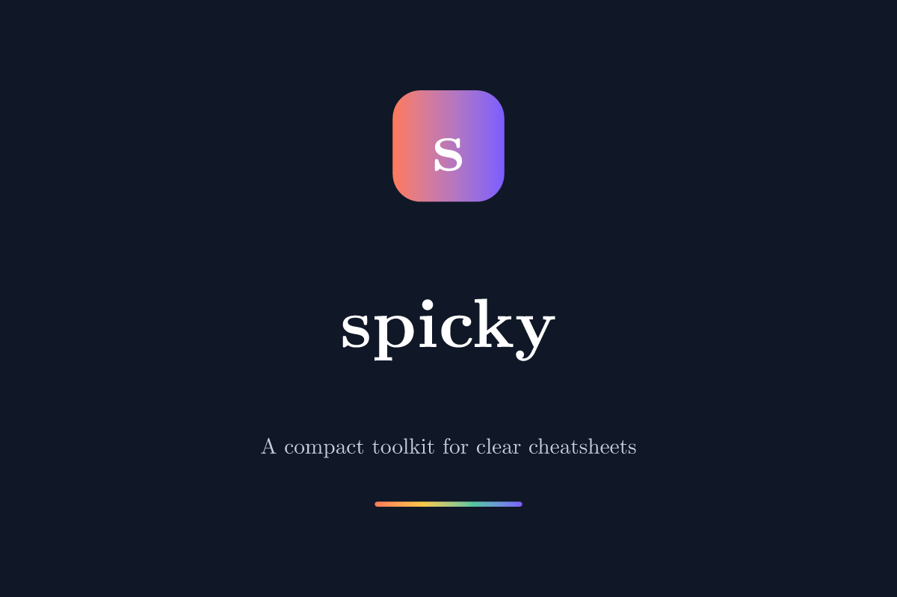
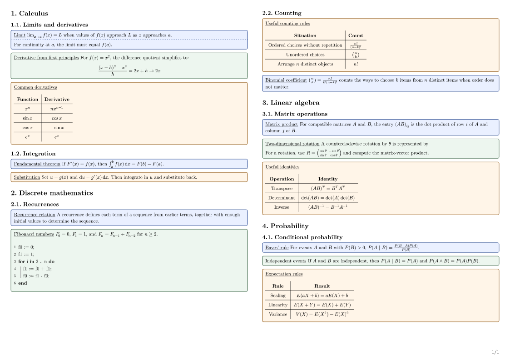

<p align="center">
  
</p>

# Spicky

**A compact, customizable toolkit for clear multi-column cheatsheets.** Spicky pairs a practical page preset with reusable definition, example, recipe, table, and pseudocode helpers.

## Quick start

Create a Typst project from the **Spicky Cheatsheet** template in Typst Universe, or add the package to a document:

```typ
#import "@preview/spicky:0.2.0": *

#show: conf.with(
  title: "My Cheatsheet",
  authors: ("Your Name",),
  description: "A concise reference for the course.",
)

= Core ideas

#definition[Definition][
  A useful fact, stated clearly.
][
  Add a short caveat or reminder in the optional footer.
]

#example[Example][
  Show the idea in context.
]

#recipe[Recipe][
  Write a short procedure or list of steps.
]

#grid[
  | *Symbol* | *Meaning* |
  | --- | --- |
  | $alpha$ | First item |
  | $beta$ | Second item |
]

#pseudo[
  + input := data;
  + *for* item *in* input *do*
    + process(item);
  + *end*
]
```

## Rendered example

The [source example](https://github.com/bfeitknecht/spicky/blob/main/docs/example.typ) builds a compact two-column reference sheet:



The `conf` preset uses landscape pages, three columns, compact New Computer Modern text, and numbered headings. Spicky targets Typst 0.13.1 or newer, matching the minimum supported compiler of its visualization dependencies. Override only what you need:

```typ
#show: conf.with(
  title: "Linear Algebra",
  authors: ("A. Student",),
  columns: 2,
  margin: 8pt,
  gutter: 4%,
  size: 9pt,
  lang: "en",
  page-numbering: "1/1",
  heading-numbering: "1.1.",
)
```

## Helpers

- `definition`, `example`, and `recipe` create lightly tinted boxes that stay together by default. Pass a title and body; an optional third content argument becomes a footer. Customize `fill`, `border-color`, `thickness`, `radius`, `inset`, or `breakable` with named arguments.
- `container` is the lower-level box helper when you want your own fill and border.
- `grid` wraps `tablem` with centered cells and subtle internal rules. It accepts the usual table arguments.
- `pseudo` and `pseudocode` both expose Lovelace's pseudocode list helper.

Spicky also brings a small set of re-exports into scope: `showybox`, `tablem`, `listtree`, `syntree`, `automaton`, `lq` (Lilaq), and `fletcher` helpers (`diagram`, `edge`, `node`). See the linked packages for their full APIs.

## Development

Requirements: [Typst](https://typst.app/) and [just](https://just.systems/).

```sh
just test       # compile the usage example, re-exports, and packaged starter template
just doc        # rebuild the manual, thumbnail, and example preview
just package out
```

`just test` compiles the usage example, verifies the documented re-exports, and compiles the starter template against the local package archive. `just doc` rebuilds the [PDF manual](docs/manual.pdf) and refreshes the preview images.

## Releases and Typst Universe

Release tags use `v<version>` and must match `typst.toml`. A GitHub Release is created for each tag. The optional Universe submission job opens a draft PR against `typst/packages` and is gated until configured; see the [release setup guide](https://github.com/bfeitknecht/spicky/blob/main/docs/release.md) for repository secrets and variables. No credentials are needed for normal CI.

## License and acknowledgments

Spicky is released under the [Unlicense](LICENSE.md). It builds on [Showybox](https://github.com/typst/packages/tree/main/packages/preview/showybox/2.0.4), [Tablem](https://github.com/typst/packages/tree/main/packages/preview/tablem/0.3.0), [Lovelace](https://github.com/typst/packages/tree/main/packages/preview/lovelace/0.3.1), [Syntree](https://github.com/typst/packages/tree/main/packages/preview/syntree/0.3.1), [Finite](https://github.com/typst/packages/tree/main/packages/preview/finite/0.5.1), [Lilaq](https://github.com/typst/packages/tree/main/packages/preview/lilaq/0.6.0), and [Fletcher](https://github.com/typst/packages/tree/main/packages/preview/fletcher/0.5.8). Thanks to their authors and maintainers.
